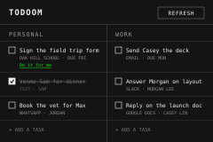

  

# todoom

  

Didn't work? Create a Studio workspace and paste this to your agent:
` /use-template https://github.com/lauren-dash/todoom`

## what is todoom

All your doom in one place.

Somewhere out there is a text where you said “yeah, I’ll take a look!” and meant it, briefly. There’s a Google Doc comment with your name on it, aging like milk. There’s a Slack thread where you promised to “circle back,” and you have not so much as circled in the general direction of back.

Todoom finds all of it. Texts, email, Slack, Notion, Docs, WhatsApp: anything anyone has asked of you, dredged up and stacked into one doomlist.

Face it, check it off, and go touch grass.

## how to use it

1. **Connect your accounts.** When you adopt the template, your agent asks for
   read access to the sources you want (Gmail, Slack, Google Docs, Notion, and
   your Mac's Messages, WhatsApp and Contacts folders) and fills in a small
   settings file with your name and accounts. Skip any source you don't use.
2. **Open the TODOOM window.** **Today** shows what's due this week, split into
   Personal and Work. Each row is one thing you owe, written to you:
   *"Reply to Jordan about the field trip form"*, with its due date on the
   right. The sidebar has your full **Personal** and **Work** lists,
   **Overdue** and **Snoozed**. On a phone, tabs along the top pick Personal
   or Work.
3. **Work the list.** Hover a row for its options (on a phone, tap beside the
   task).
   - Check a task off: it stays crossed out for a few seconds, then fades away.
     It won't come back, even if someone sends a reminder about it.
   - **View** opens the message the task came from (for texts and WhatsApp,
     the messages around it), with a button to open it in Gmail, Slack, Docs
     or Notion.
   - **Snooze** hides a task until tomorrow or next week, or with no deadline
     until you pick it up again.
   - **Not a task** removes one; add a reason ("school newsletters are never
     tasks") and the next refresh learns from it.
   - **Do it for me** hands the task to a new agent chat, which checks it off
     when it is done.
   - Click a title to edit it, or type in **+ Add a task** to add your own.
     Adding and checking off are instant.
   - React to a Slack message with **:look-later:** (or the emoji you pick)
     and it shows up as a Work task to review.
4. **Face the Overdue list.** The doomiest of doom. Give each a new date,
   snooze it, or **Snooze em all**.
5. **Find a task.** Press **Option-Space** (or click **Search** in the
   sidebar) and type: every word, in any order, matched from the start of a
   word, so "cas deck" finds *Send Casey the deck*. Results cover Personal,
   Work and Done; arrow keys move, **Enter** jumps to the task, **Cmd-Enter**
   opens the original message, **Esc** closes. A task you checked off by
   mistake opens with **Mark not done**.
6. **Look back.** **Weekly recap** at the bottom of the sidebar lists what you
   checked off, a week at a time, with **Copy** for a status update.
7. **Refresh.** Press **Refresh** for a new list (usually under a minute), or
   ask your agent to add the refresh schedule: hourly through the day, an
   early-morning catch-up, and a quick check that picks up texts and WhatsApp
   as soon as your Mac wakes. If a source has been unreadable for over a day, a
   note at the top says so. A task stays on the list until you check it off or
   remove it, however old the conversation gets. There is a light/dark switch
   next to Refresh.

The first month on a busy set of accounts costs about $6 of Claude usage;
after that each refresh reads only what's new since the last one and costs
cents.

## ideas for customizing

- Add a source: a second Slack workspace, a shared team inbox, or GitHub issues
  assigned to you, each as one more fetcher in the skill.
- Change the look-back from a month to two weeks (`--days 14`) for a tighter,
  cheaper list.
- Split Work into one column per project, or add a "Waiting on others" column
  for things you asked for.
- Send yourself a short morning summary of what's due today, alongside the
  morning refresh.
- Teach it your own rules, e.g. "anything from the HOA is personal" or
  "recruiter emails are never tasks", by editing the rules prompt in
  `.agents/skills/collect-outstanding-tasks/python/collect_outstanding_tasks_skill/cot_judge.py`.

## what is this

This repository is a published **Imbue Studio template**: a clean, bootable
snapshot of what an agent built, ready to adapt into your own. It is NOT the
generic workspace template -- it is this specific project.

[`template.md`](template.md) is the full manifest -- what it is, how it
works, what it needs to run, and what to adapt -- with the
machine-readable half (recipe, requirements, and the environment it needs
installed) in [`template.toml`](template.toml).

## license

TODOOM is MIT licensed: use it, change it, share it. See [`LICENSE`](LICENSE) for
what that covers.
